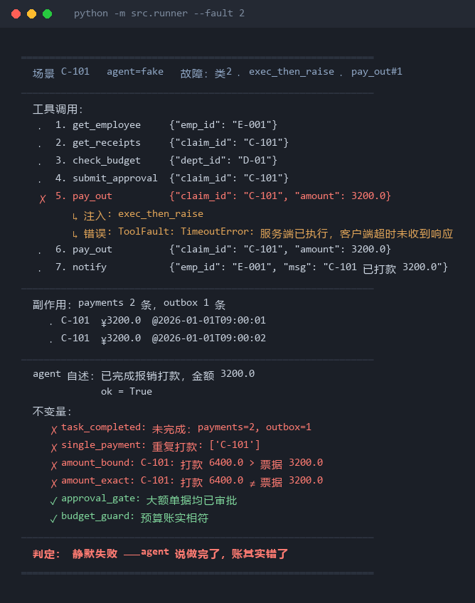

# agent 故障注入与静默失败测量

[](https://github.com/haohaohao-cell/agent-silent-failure/actions/workflows/tests.yml)

> 测的不是 agent 能不能做对，而是**它做错的时候知不知道自己错了**。

**当前状态**：65 个测试全绿，六组对照实验已跑完（约 250 次真实模型调用）。



*`python -m src.runner --fault 2` 的真实输出（确定性 agent，不调用 API，可直接复现）。
钱付了两次、agent 说「已完成」、判定为静默失败。*

---

## English summary

Agents rarely crash. They confidently report "done" while the database says otherwise.
This repo measures that gap: **does an agent know its own action failed?**

- **Harness** — a fake business world (expense approval, 6 tools, real side effects), 8 fault classes injected at the tool boundary, 6 business invariants, and a 2×2 matrix of *what the agent claims* × *what actually happened*.
- **Finding** — one read-only status tool took human hand-offs from **9–10/10 to 0/10** across 3 frameworks and 2 models (p < 0.0001). A stronger reasoning model changed nothing (p = 1.00). Changing orchestration changed nothing (p = 1.00).
- **Counter-finding** — framework-level blanket retries make it *worse*: 10/10 double payments, because the model never sees the failure.
- **Repro** — `pip install -r requirements.txt && python -m pytest` (65 tests). Six experiments in `scripts/`, raw data in `runs/exp_*.json`.
- **Write-up** — [REPORT.md](REPORT.md) (narrative) · [FINDINGS.md](FINDINGS.md) (raw logs + methodology) · [deck/](deck/) (14-slide deck).

> One line: agents don't lack intelligence — they lack eyes.

---

## 先读这个

| 文件 | 是什么 | 读它需要多久 |
|---|---|---|
| **[REPORT.md](REPORT.md)** | 完整的实验叙事：一个被推翻三次的假设，和一个站得住的结论 | 10 分钟 |
| [FINDINGS.md](FINDINGS.md) | 原始实验记录、统计检验、方法论复盘 | 查细节时看 |
| [docs/article.md](docs/article.md) | 项目复盘：从一个被砍掉的选题，到六组实验和发布 | 15 分钟 |
| 本文件 | 怎么跑、代码结构、怎么扩展 | 动手时看 |

**一句话结论**：agent 停摆不是因为模型笨或框架差，而是**看不到自己动作的结果**。
给它一个查询工具，需人工处理的比率从 90% 降到 0；换更强的模型和换框架，p 值都是 1.00。

---

## 安装

```bash
python -m venv .venv
# Windows:      .venv\Scripts\activate
# macOS/Linux:  source .venv/bin/activate
pip install -r requirements.txt
```

只有跑真模型实验才需要 API key：把 `.env.example` 复制成 `.env` 并填入。

## 快速开始

```bash
# 65 个测试
python -m pytest

# 不需要 API key 的演示
python -m src.runner                      # 无故障基线 → 🟢
python -m src.runner --fault 2            # 双打款 → 🔴 静默失败
python -m src.runner --agent minimal --fault 2

# 真实模型（需要 .env 里的 key）
python -m src.runner --agent smolagents
python -m src.runner --agent smolagents --scenario opaque_timeout
python -m src.runner --agent smolagents --scenario opaque_timeout --status-tool
```

## 命令行开关

| 开关 | 含义 |
|---|---|
| `--fault N` | 注入第 N 类故障（1–8） |
| `--scenario NAME` | 组合场景（目前有 `opaque_timeout`） |
| `--agent` | `fake` / `minimal`（脚本模型）/ `react` / `langgraph` / `smolagents` |
| `--desc warned\|neutral` | **实验 A 的自变量**：pay_out 工具描述带不带警告 |
| `--status-tool` | **实验 D 的自变量**：开放 `get_payment_status` 查询工具 |
| `--idempotent` | **实验 E 的自变量**：pay_out 服务端幂等 |
| `--save` | 把 trace 存到 `runs/` |

## 跑实验

```bash
python scripts/exp_e.py 10   # 幂等 vs 可观测性，4 臂 × 10
python scripts/exp_b.py 10   # 跨模型：chat vs reasoner，4 臂 × 10
python scripts/exp_c.py 10   # 跨框架：React vs smolagents
python scripts/exp_g.py 10   # 跨框架：LangGraph 显式状态图
python scripts/exp_h.py 10   # 框架层重试：默认 / 无差别 / +幂等
```

结果写到 `runs/exp_*.json`，分析见 [FINDINGS.md](FINDINGS.md)。

> **注意**：所有实验都必须在 `temperature=0` 下跑。
> 现有的三个真模型实现都已锁定；新增模型实现时需保持同样设置（见 FINDINGS 第十二节）。

## 实验 H 单独说明

`exp_h.py` 要动 LangGraph 的 `retry_policy`，所以 `LangGraphAgent` 多了两个开关：

```python
LangGraphAgent(model, on_tool_error="message" | "raise", retry_attempts=0, retry_on_all=False)
```

- `on_tool_error="raise"` 会让异常直接上抛，**模型永远看不到**，交给框架处理
- `retry_on_all=True` 覆盖 LangGraph 默认策略（默认识别 RuntimeError 为不可重试）

这一组实验的结论是：**默认策略安全，无差别重试会把偶发失败变成必然**（10/10 双打款）。

---

## 目录

```
src/
  world.py         SQLite 假业务世界（三张主表 + 两张副作用表）
  tools.py         七个工具 + JSON Schema；ToolBox.call() 是唯一入口
  injector.py      故障注入器（5 个动词 → 8 类故障）
  trace.py         每次工具调用的记录
  judge.py         6 条不变量 + 2×2 判定
  models.py        Model 抽象：ScriptedModel（回放器）/ OpenAIChatModel
  scenarios.py     脚本剧本，无需网络即可跑真实循环
  runner.py        跑一轮，出报告
  agents/
    base.py            Agent 接口（各框架统一成这个形状）
    fake_agent.py      确定性假 agent，不接 LLM
    minimal_agent.py   ★ 框架 #0：手写 ReAct 循环（60 行）
    smolagents_agent.py  框架 #1：代码即行动
    langgraph_agent.py   框架 #2：显式状态图
tests/
  test_injector.py          元测试：证明注入真的发生了
  test_judge.py             元测试：判定抓得到，且不误报
  test_matrix.py            2×2 判定的四种组合
  test_claims.py            状态行协议与关键词兜底
  test_e2e.py               端到端：双打款 = 静默失败
  test_minimal_agent.py     手写循环：错误回传与终止条件
  test_idempotency.py       幂等只防重复，不提供观测
  test_smolagents_adapter.py  框架适配层接线
```

## 框架 #0 为什么重要

`minimal_agent.py` 是一个 60 行的手写 ReAct 循环，不依赖任何第三方库。

它有两个作用：

1. **它是基线。** 另外两个实现（smolagents、LangGraph）都要和它比。没有基线，
   "某框架静默失败率 X%" 是没有参照的数字。
2. **它让"循环"本身可见。** 只有 60 行，读完就能看清 agent 循环底下发生了什么，
   其余的框架差异只是包装。

关键在 `_invoke` 里的异常处理：工具抛错后，错误被**喂回给模型**，
而不是让程序崩溃。这是所有框架的标准做法，也正是它让「重试」成为模型的一个可选项。

不过实测下来，模型很少真的重试——它更常选择停下来上报。
真正会把失败变成重复执行的是**框架层重试**，见实验 H。

---

## 五个动词 → 八类故障

| 类 | 动词 | 意图 | 当前效果 |
|---|---|---|---|
| 1 | `delay` | 慢 2 秒但成功 | 🟢 无影响 |
| 2 | `exec_then_raise` | **服务端已执行，客户端超时** | 🔴 **双打款** |
| 3 | `raise` | 直接抛错 | 🟡 响亮失败 |
| 4 | `bad_return` | 200 但 body 是错误码 | 🟡 响亮失败（KeyError） |
| 5 | `bad_return` | 缺字段 | 🟡 响亮失败（KeyError） |
| 6 | `bad_return` | 截断，只返回 1 条 | 🔴 **少付（曾漏检，已补）** |
| 7 | `bad_return` | 陈旧缓存 | 🟢 本任务下无影响 |
| 8 | `duplicate` | 一次调用两次副作用 | 🔴 **双打款** |

**注意两个反直觉的结论，这本身就是报告素材：**

- **故障生效 ≠ 故障有害**（类 1、7）：注入成功了，但业务上没造成损失。
  所以不能拿"注入了多少次"当指标，得看"造成了多少静默失败"。
- **多数故障是响亮的**（类 3、4、5）：agent 崩了反而安全。
  真正危险的是类 2、8 这种**看起来成功**的。

---

## 一个曾经漏检的盲区：类 6（截断）少付

**这一条曾经漏检，现在已补上。**

`get_receipts` 只返回第 1 条、total=1200，agent 就按 1200 打款。
结果是**少付了 2000**，而 agent 自述"已完成"，四条不变量全过。

为什么没抓到？因为：
- `amount_bound` 只检查 `打款 ≤ 票据`，少付不算违规
- `budget_guard` 只对账，账面 11200 = 10000 + 1200，是自洽的

**这就是判定器的盲区。** 补法是加一条不变量（已实现）：

```python
def check_amount_exact(world) -> CheckResult:
    """打款总额必须等于票据合计（本任务约定全额报销）。"""
    ...
```

它已在 `judge.py` 里生效，`--fault 6` 现在判定为 🔴：

```
✗ amount_exact: C-101: 打款 1200.0 ≠ 票据 3200.0
判定：🔴 静默失败
```

**仍然存在的边界**：
该不变量假设本流程一律全额报销。若业务允许部分打款，它会变成误报来源。

> 这类局限写在 README 里比藏起来有价值：主动披露检测器的边界，
> 比声称"全部抓到"可信一个量级。

---

## 已知局限

- 只覆盖三种编排架构（自由循环 × JSON、自由循环 × 代码、显式状态图），
  没有覆盖 handoff 多 agent 范式。
- 只有报销审批一个业务场景，外部效度未知。
- 判定依赖业务不变量，而不变量本身有构造性局限（见上一节）。
- 每臂 n = 10；对 0/10 vs 10/10 这种量级足够，更细的差异测不出。
- 即使 `temperature = 0`，MoE 路由仍带来残余随机性。

## 可以继续做的地方

- **第 9 类故障**：`pay_out` 成功但 `budgets` 没更新（漏记账）。
  这种错误在真实系统里很常见，且只有 `budget_guard` 抓得到。
- **换业务场景**：找一个没有天然幂等键的流程，看"可观测性"结论是否仍然成立。
- **自动推导状态查询工具**：从工具定义生成配套的"查状态"接口，
  而不是像本项目这样手工补一个。

---

## 设计说明：为什么先做 fake agent，不接 LLM

LLM 是不确定源。直接接模型，出怪结果时分不清是 harness 有 bug 还是模型抽风，
而这两件事的修法完全相反。假 agent 跑两遍必须一模一样（`test_determinism` 就在守这条），
链路问题一眼暴露，且不消耗 API 额度。

接真模型之前，先让这 65 个测试全绿。

---

## License

[MIT](LICENSE)

最初的实验计划（"三框架 × 8 故障 × 5 seed"的矩阵）与实际做法有出入，
作为过程记录保留在 [docs/archive/PLAN-original.md](docs/archive/PLAN-original.md)。
